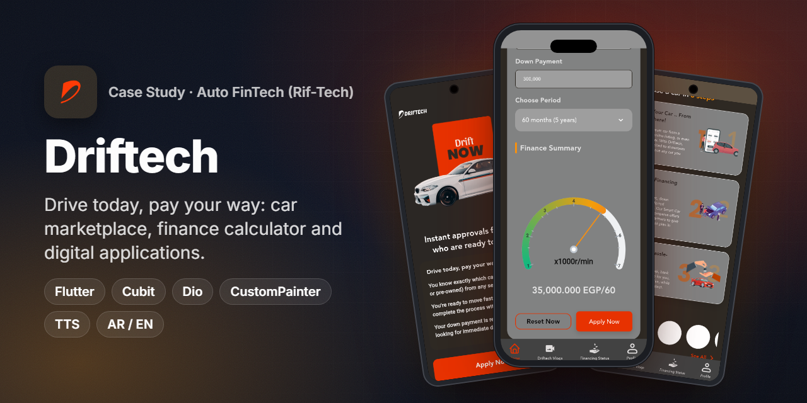
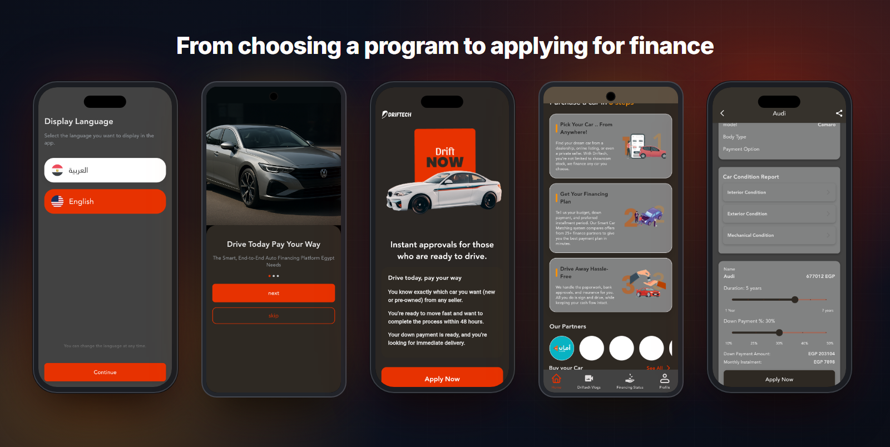
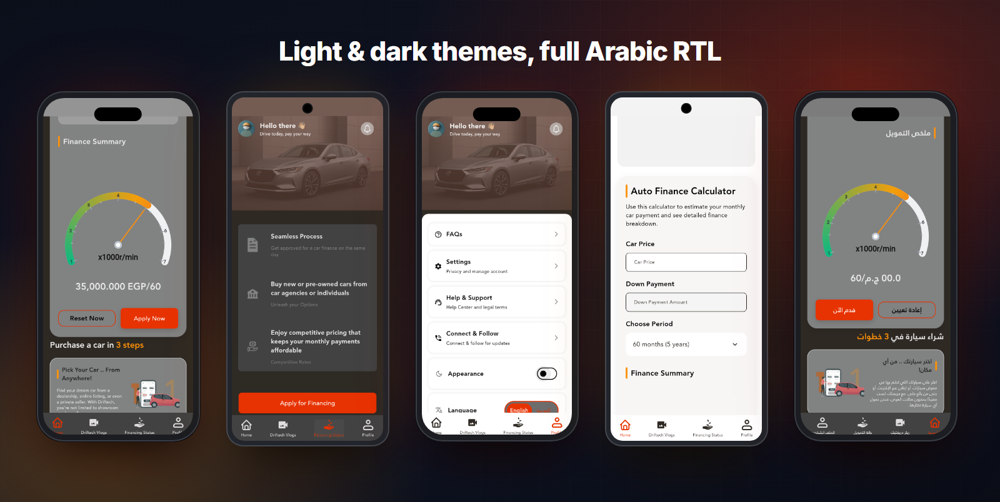
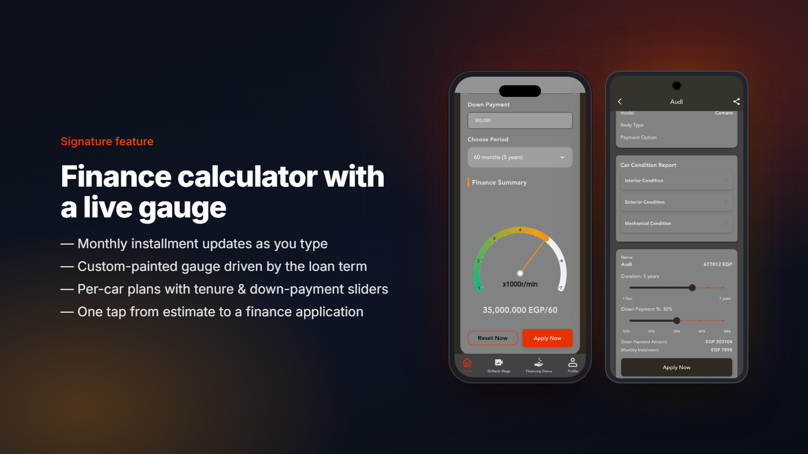
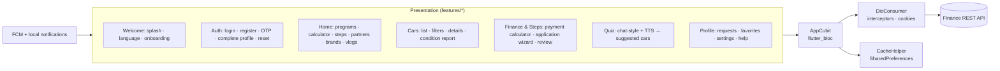

<h1 align="center">Driftech (Rif-Tech)</h1>

<b>Car financing for Egypt: pick any car, see your installment instantly, and apply for finance from your phone.</b>

  
  
  
  
  
  
  

> ℹ️ Case study. The source code belongs to the client and is not included.

## Overview
**Driftech** (built for **Rif-Tech**) is an auto-finance app for the Egyptian market. Its promise is *"Drive today, pay your way"*: the customer can choose any car (new or pre-owned, from a dealer or a private seller), estimate the monthly installment and apply for financing digitally. The app combines a car marketplace, a finance calculator, financing programs, a guided car-matching quiz and application tracking.

- **Market:** Egypt. Arabic and English, with a full RTL layout.
- **My role:** Flutter developer. I built the full mobile client: UI, Cubit state, REST integration, notifications, theming and localization.
- **Distribution:** Delivered to the client. It is not on a public store listing at the time of writing.

## The challenge
- Car finance is intimidating. Users need a **clear monthly number** before they will commit to a long application.
- Financing comes in several programs (instant purchase, trade-in, multi-car fleet, savings-oriented plans). Each one targets a different customer and needed its own entry point.
- Many users don't know which car fits their budget yet, so the app had to **guide** them instead of only listing inventory.
- The finance application collects a lot of data (personal, employment, financial profile, car). It had to be split into short, reviewable steps.

## Highlights
**🚗 Marketplace**
- Car listings with price-range tabs, popular brands, new / pre-owned / electric / imported categories, and similar cars.
- Filters: price, kilometers, year, transmission, model and installment, plus sorting (price, km, year, recently added).
- Car details with an image slider, specs, a **condition report** (interior / exterior / mechanical) and share.
- Favorites and **saved searches**.

**💸 Financing**
- **Auto Finance Calculator** on the home screen, with a custom-painted gauge that updates live.
- Per-car finance section: duration and down-payment sliders show the monthly installment and down-payment amount.
- Payment-calculator screen that loads server-side installment plans (term, monthly amount, interest %) for a given price and down payment.
- **"Which Drifter are you?"** financing programs: *Drift NOW* (instant approval), *Drift TRADE* (trade-in), *Drift Fleet* (2+ cars), *Drift & Save* (lowest interest or lowest down payment).
- Multi-step application wizard: personal info → education & employment → financial profile → car details → review. Requests can be tracked and cancelled under *Financing Status*.

**🤖 Guided matching**
- "Know your car" quiz styled as a chat with an AI-assistant intro and countdown. Questions are read aloud with **text-to-speech** in Arabic or English, previous answers can be edited, and the results lead to suggested cars.

**👤 Account & app**
- Phone + OTP registration, login, reset password, change phone, and account deletion (with a 90-day reactivation window).
- Notifications center + FCM push, help center / support tickets, FAQs, contact & follow.
- **Dark and light themes**, adjustable font size, Arabic/English switch, and the *Driftech Vlogs* video section.

## Screens
Real screenshots, captured from the app's own UI running as a Flutter web build in guest mode. Inventory and banners come from the live catalog. Some remote images did not load in the web build, and the quiz requires a signed-in user, so it is not shown.

Language picker · onboarding · Drift NOW program · "Purchase a car in 3 steps" + partners · car details with finance sliders

Calculator result (dark) · financing status · profile & appearance toggle · calculator (light) · Arabic RTL

## Signature feature

**A monthly number before anything else.** The calculator sits on the home screen, above the fold of the financing content:

1. The user types the **car price** and **down payment** and picks a **period** (12–84 months) from a bottom-sheet selector.
2. On every keystroke the widget recalculates the installment: *loan = price − down payment*, flat annual interest over the term, divided by the number of months.
3. A **custom `CustomPainter` gauge** (sweep-gradient arc, ticks, needle) moves with the selected term, from 1 to 7 years, so the trade-off between term and payment is visible at a glance.
4. **Apply Now** goes straight into the finance flow. On a car's detail page the same idea becomes duration and down-payment **sliders** tied to that car's price.

For exact offers, the payment-calculator screen requests the server's installment plans for the chosen price and down payment and shows each plan's term, monthly amount and interest.

## Architecture & stack

| Layer | Tech |
|---|---|
| UI | Flutter, `flutter_screenutil`, `flutter_svg`, `carousel_slider`, `smooth_page_indicator`, `dropdown_button2`, `shimmer`, `lottie`, `photo_view`, `flutter_rating_bar` |
| Custom drawing | `CustomPainter` finance gauge |
| State management | `flutter_bloc` (Cubit) with a `BlocObserver` |
| Networking | `dio` + `cookie_jar` / `dio_cookie_manager`, centralized endpoints and status codes |
| Persistence | `shared_preferences` (session, theme, language, wallet) |
| Media | `video_player`, `video_thumbnail`, `cached_network_image`, `image_picker` |
| Voice | `flutter_tts` (Arabic / English) for the quiz assistant |
| Localization | `easy_localization` (ar-EG / en-US), Janna LT, Cairo and Archivo Narrow fonts |
| Notifications | `firebase_core`, `firebase_messaging`, `flutter_local_notifications` |

## Engineering notes
- **Live calculator, no round-trip.** The home calculator runs its math locally inside `onChanged`, so the number responds instantly while the user is still deciding. Exact, binding plans come from the server only on the dedicated calculator screen.
- **Gauge as a painter, not a package.** The finance gauge is a custom `CustomPainter` (sweep-gradient arc, ticks, needle) normalised to the loan term. It is lightweight, follows the theme, and needs no chart dependency.
- **TTS that never blocks the UI.** Quiz prompts are spoken through `flutter_tts` with a *speak-with-timeout fallback*. If the TTS engine stalls or isn't available, the chat continues on a visual timer. Question marks are normalised per language (`?` vs `؟`) for both display and speech.
- **Guest-first startup.** The app loads public content (brands, cars, banners, partners, videos, contact info) at launch. User data (requests, favorites, saved searches, quiz) is fetched only once a session exists, so first paint stays fast for visitors.
- **Theme-aware brand assets.** The program badges and home surfaces switch between light and dark artwork through the Cubit's theme flag, so the brand stays consistent in both modes.
- **RTL everywhere.** Layouts use directional paddings and positioning (`PositionedDirectional`, `EdgeInsetsDirectional`). Arabic mirrors correctly down to sliders and the bottom navigation.

## Results
- One app combining a **car marketplace, finance calculator, 4 financing programs, a guided quiz and application tracking**.
- Fully bilingual (**Arabic RTL + English**) with dark and light themes.
- Delivered to the client. No public store listing is available to cite.

## بالعربي
**Driftech** (لشركة Rif-Tech) تطبيق تمويل سيارات في مصر. فكرته "سوق النهارده وادفع بطريقتك": العميل يختار أي عربية، زيرو أو مستعملة، ويعرف القسط الشهري فورًا، وبعدها يقدّم على التمويل من الموبايل.
فيه حاسبة تمويل بعدّاد مرسوم بـ CustomPainter بيتحرك مع مدة القرض، وأربع برامج تمويل (Drift NOW وTRADE وFleet وSave)، وكويز بأسلوب شات بيقرأ الأسئلة بصوت، وفلاتر ومفضلة، وعمليات بحث محفوظة، ومتابعة لطلبات التمويل.
اتبنى بـ Flutter وCubit وDio وFCM، وبيدعم العربي والإنجليزي بالكامل مع وضع ليلي ونهاري.

## Links
- Not publicly listed on the stores. Screens above are real UI captures.
- More of my work: [Portfolio](https://anashaker.github.io/shaker_portfolio/)

---
<h3 align="center">Built by Mahmoud Shaker — Senior Flutter Engineer</h3>

  
  
  
  
  
  
  

